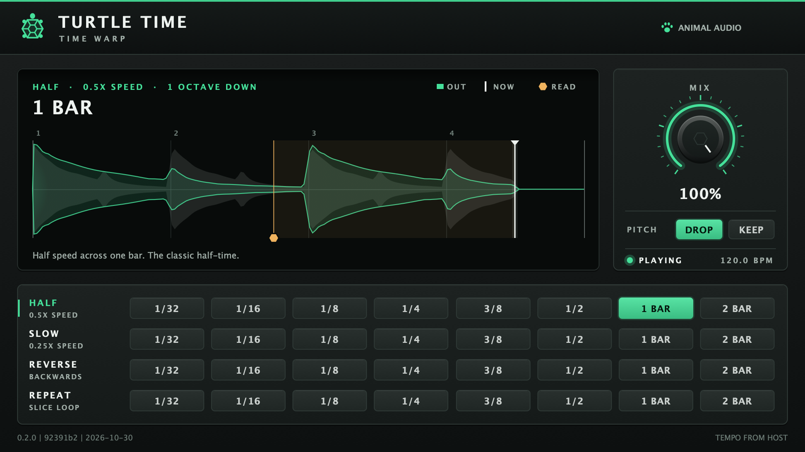
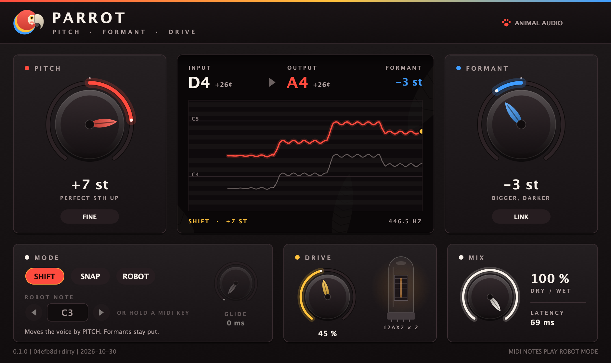
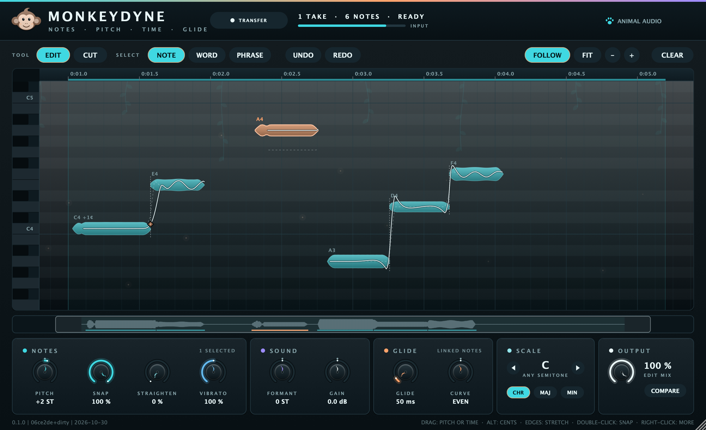

<h1 align="center">Animal Audio</h1>
<p align="center"><b>A series of VST3 plugins with juice, for Ableton Live and any other VST3 host.</b></p>

<p align="center">
  
</p>

Every plugin in the series is built from the same toolbox: JUCE + CMake, shared DSP/UI libraries,
realtime-safe processing, and a bold, playful look with a bit of animal personality.

## Get started

**Use plugins in Ableton (or any VST3 host):**

1. `git clone https://github.com/SammyEl-Sherif/animal-audio-plugins.git && cd animal-audio-plugins`
2. Run **`/setup`** in Cursor or Claude Code, or by hand:
   `python3 scripts/install_plugins.py --build --clean` (`--prereqs` first; `--dry-run` to preview).
3. In **Ableton Live → Preferences → Plug-ins**, enable **Use VST3 Plug-In System Folders** and **Rescan**
   (hold **Alt** / **Option** for a full rescan if needed).
4. Add a plugin from **Plug-Ins → VST3 → Animal Audio** on an audio track. Confirm the **build stamp**
   (hover the ANIMAL AUDIO badge) matches what the install script printed.

Details: [Install](#install) and `.cursor/skills/setup/SKILL.md`.

**Create a new plugin in the series** — animal-themed design (palette, Motif, BrandBadge), shared DSP/widgets as needed:

```bash
# In Cursor or Claude Code, e.g. /vst Otter — tempo-synced stereo wobbler
python3 scripts/new_plugin.py Wobble --description "One-line description"
scripts/verify_plugin.sh Wobble
```

The **`/vst`** skill (`.cursor/skills/vst/SKILL.md`) walks through scaffold, Theme/Motif, DRY extraction to
`shared/`, building **all** plugins, fixing build errors, tests, and docs. More detail: [Adding a plugin](#adding-a-plugin)
and [AGENTS.md](AGENTS.md).

| Skill | When to use |
| --- | --- |
| **`/setup`** | New dev or tester: clone, build, install VST3s, rescan in Ableton |
| **`/vst`** | New Animal Audio effect: animal-themed UI + shared libraries (layout is up to the concept), ready to release |
| **`/release`** | Maintainers: ship a merged plugin (notarized Mac `.pkg`, Windows zip, GitHub Release) and list it on animal.audio |

## The series

<!-- PLUGINS:START -->
| Plugin | What it does | Source | Status |
| --- | --- | --- | --- |
| **Duck** | Tempo-synced volume ducking with a draggable curve editor, 16 preset shapes and a big MIX knob | `plugins/duck` | Alpha: builds as VST3, all tests pass, passes pluginval level 10 on Linux; not yet tried in a real DAW |
| **Turtle Time** | Tempo-synced half-time, reverse, and beat repeat | `plugins/turtletime` | Private beta (0.1.0): VST3 builds, plugin tests pass, passes pluginval level 10 on macOS; loaded in Ableton Live on macOS |
| **Parrot** | Pitch and formant voice bender with snap, robot and tube drive | `plugins/parrot` | Alpha (0.1.0): VST3 builds, plugin tests pass, passes pluginval level 10 on macOS; not yet tried in a DAW |
| **Monkeydyne** | Note-based vocal editor: move, snap, stretch and glide every note | `plugins/monkeydyne` | Alpha (0.1.0): VST3 builds, plugin tests pass, passes pluginval level 10 on macOS (GUI tests skipped); not yet tried in a DAW |
<!-- PLUGINS:END -->

More animals are on the way. Adding one takes a single command (or the `/vst` agent skill), see [Adding a plugin](#adding-a-plugin).

## Duck

A volume shaper in the spirit of the classic sidechain-free "kick ducking" tools: it dips your signal
on every beat and lets it swim back up along a curve you draw. No sidechain routing, no kick needed.

- **Time divisions** `1/8`, `1/4`, `1/2`, `1/1`: one duck per note division, locked to the host's
  playhead (PPQ) and tempo.
- **Free-run fallback**: when the transport is stopped, or a host reports no position, Duck keeps
  going at the host BPM (or the *Fallback BPM* slider) so you can always hear what you are drawing.
  The status pill shows `HOST SYNC` or `FREE RUN`.
- **MIX** (the big rubber-duck knob): dry/wet of the *ducking effect*. 0% is a bit-exact bypass,
  100% applies the full curve.
- **Editable curve**: drag nodes, drag the diamond handles to bend a segment, double-click to add
  or remove nodes (up to 16). `FLIP` mirrors the curve in time, `INVERT` turns it upside down.
- **16 preset shapes** in two rows, plus prev/next buttons. A rubber duck rides the curve at the
  playhead, and the post-duck signal level is drawn behind it.
- **Click-free**: all gain changes (including hard-edged curves, mix and curve edits) go through
  a ~0.7 ms declick smoother. The audio thread never allocates, locks or does I/O.
- **State**: parameters and the curve are saved with your Live set / preset (APVTS ValueTree).

<p align="center">
  
</p>

> Both screenshots are rendered by the UI code itself, headlessly, in the test suite
> (`AA_SCREENSHOT_DIR=docs/images ./build/plugins/duck/DuckTests "duck: editor renders headlessly"`).

## Turtle Time

A tempo-synced time effect in the spirit of half-time tools: it plays the signal back slower (or backwards,
or as a repeating slice) and jumps back onto the grid so the pitch drop stays in time. No separate sidechain.

- **32 time patterns** in a matrix: pick a behaviour row (HALF 0.5x, SLOW 0.25x, REVERSE, REPEAT slice loop)
  and a length column (1/32 up to 2 bars). The default is half speed across one bar.
- **Host playhead**: while the transport is playing the window locks to the host position and the display
  moves with it. Stopped, the effect passes audio dry and the display freezes. Tempo always comes from the
  host; the MIX panel shows `PLAYING` / `STOPPED` and the host BPM.
- **Display**: input (grey) and output (green) over the current window. The white line is "now"; the amber
  read head marks the audio actually being played, so you can see the lag.
- **MIX**: dry/wet. 100% is the full effect (the default). 0% is a straight copy of the input. Mix moves are smoothed.
- **Click-free**: pointer jumps crossfade over about 10 ms. The audio thread never allocates, locks, or does I/O.
- **State**: pattern and mix are saved with the Live set (APVTS).

<p align="center">
  
</p>

> Screenshot from `AA_SCREENSHOT_DIR=docs/images ./build/plugins/turtletime/TurtleTimeTests "turtletime: editor renders headlessly"`.

## Parrot

A real-time voice bender: move the pitch and the formants of a voice independently, pull it onto semitones or
hold it on one robot note, then push it through a modelled tube preamp.

- **PITCH and FORMANT**, each ±12 semitones and independent: pitch up with formants down gives a big, deep
  character; formants alone change the apparent size of the singer. FINE off moves both in whole semitones;
  **LINK** makes the formants follow the pitch, like a tape or sampler (chipmunk up, giant down).
- **Modes**: SHIFT transposes. SNAP pulls each note to the nearest semitone, then transposes; GLIDE softens the
  pull. ROBOT holds one steady note, from the NOTE selector or a held MIDI key (route a MIDI track to Parrot in
  Live), transposed by PITCH; GLIDE gives it portamento.
- **How it works**: a YIN pitch tracker (de Cheveigné & Kawahara, 2002) finds the period. Pitch-synchronous
  overlap-add (TD-PSOLA, Moulines & Charpentier, 1990) cuts the voice into grains one period long, centred on
  pitch marks aligned to a fraction of a sample, and re-spaces them for the new pitch; resampling each grain
  (band-limited sinc) moves the formants. Breath and consonants pass through without a pitch buzz.
  Measured in the tests: shifts land within 0.1 cent, formants within half a semitone of the target, level
  within 0.5 dB.
- **DRIVE**: two 12AX7 triode stages built from Koren's tube equation with Cohen & Hélie's measured 12AX7
  constants, including grid current and cathode bias shift, 4x oversampled and level-matched. Light settings add
  warm, mostly even harmonics; high settings compress and break up.
- **Display**: detected note and output note, the formant shift, and a pitch roll with the input (grey) and
  output (scarlet) over the last four seconds, plus the robot target.
- **MIX** blends with the dry signal, delayed to line up with the shifted one.
- **Latency**: about 69 ms at any sample rate, reported to the host, which compensates it on playback. The pitch
  tracker and the grains need that much look-ahead for the lowest voices (75 Hz), with formants lowered up to an
  octave. Monitoring through Parrot while recording will feel late.

<p align="center">
  
</p>

> Screenshot from `AA_SCREENSHOT_DIR=docs/images ./build/plugins/parrot/ParrotTests "parrot: editor renders headlessly"`.

## Monkeydyne

A note-based vocal editor. Record a vocal into Monkeydyne and it finds every note, word and phrase. Then move notes
onto other notes, set how hard each one snaps to the scale, stretch them, cut them, and shape how one note glides
into the next. The workflow takes cues from note-based pitch editors; the design, DSP and art are original.

- **Getting audio in (TRANSFER)**: Live has no ARA, so Monkeydyne records what it plays. Arm TRANSFER, play the
  passage, stop. The take sits at its place on the song timeline; from then on, while Live plays over it,
  Monkeydyne outputs the edited take instead of its input (everything else passes through). Transferring the same
  stretch again replaces the take. Takes are saved with the set as 24-bit FLAC inside the plugin state, so a reload
  gives back the same take and the same notes.
- **Analysis**: pitch by pYIN (Mauch & Dixon, 2014): YIN with a spread of thresholds and a hidden Markov model
  decoded by Viterbi, which removes the octave slips and voicing glitches plain YIN makes, then refined to a few
  cents. Words are voiced stretches; phrases are words less than 200 ms apart. Inside a word, notes are found by
  optimal change-point detection (PELT, Killick et al., 2012) on the vibrato-free pitch, plus level dips for
  re-sung syllables, and each boundary sits at the steepest point of the slide. Consonants and breaths belong to
  the note next to them, so they move with it. A 45-second vocal analyses in about 0.4 s.
- **Moving notes**: drag a note up or down in semitones (it lands on the scale) or, with Alt, in cents; sideways
  to move it in time; drag an edge to stretch it (1/4x to 4x, the consonant attack keeps its speed). A click
  selects a NOTE, WORD or PHRASE (toolbar); shift-click adds, a band drag selects many, Cmd+A selects all.
- **Shaping notes** (the selection, or every note when nothing is selected): PITCH; SNAP, how far each note's
  centre is pulled onto the scale (per note or all at once); STRAIGHTEN, which flattens slow drift and keeps the
  vibrato; VIBRATO from 0 to 200%; FORMANT; GAIN. SCALE sets the key and chromatic / major / minor for SNAP.
- **Cutting and gliding**: the CUT tool splits a note into two linked notes; move the parts onto different
  notes and they glide into each other. Untouched, a glide is the singer's own. Drag the diamond between two
  linked notes sideways for the glide time (5 to 600 ms) and up or down for its curve (leave early, or hold and
  arrive late): the sung slide is replaced by that one. Double-click the diamond to go back. Alt-click a
  separation to link or unlink notes, double-click it to merge them.
- **Workflow**: undo / redo (200 steps), a right-click menu, keys (arrows nudge pitch and time, S snaps, 0 resets
  the sound, T the timing, 1 / 2 pick the tool, F fits), an overview strip of the song, click a note while
  stopped to hear it, COMPARE for the recording, MIX between both.
- **Rendering**: TD-PSOLA (Moulines & Charpentier, 1990) from the analysis pitch marks, rendered in the
  background; formants move by resampling each grain (band-limited sinc). Only the phrases an edit touches are
  re-rendered, and they crossfade into their neighbours at pauses. On a real 45-second vocal with every note moved
  and snapped, the output pitch is within 1.2 cents of the edit (median; 90% within 6.6 cents). Exporting or
  freezing waits for the renderer, so the bounce has every edit. No latency.
- **Limits**: one voice at a time (no chords or doubled vocals). Takes are tied to song time: move the clip in
  Live and you need to transfer again, and tempo changes do not stretch takes. A take plays at the sample rate it
  was recorded at. Pitch tracking is signal processing (pYIN), not a neural tracker; very breathy or distorted
  vocals can lose notes, which cutting and merging can fix.

<p align="center">
  
</p>

> Screenshot from `AA_SCREENSHOT_DIR=docs/images ./build/plugins/monkeydyne/MonkeydyneTests "monkeydyne: editor renders headlessly"`.

## Build

Requirements: CMake 3.22+, a C++17 compiler, and Ninja (optional, recommended). JUCE and Catch2 are
downloaded by CMake at configure time (pinned in `cmake/FetchDependencies.cmake`).

**Linux** (Debian/Ubuntu)

```bash
sudo apt-get install ninja-build libasound2-dev libfreetype-dev libfontconfig1-dev libx11-dev \
  libxrandr-dev libxinerama-dev libxcursor-dev libxext-dev libgl1-mesa-dev libcurl4-openssl-dev
cmake -S . -B build -G Ninja -DCMAKE_BUILD_TYPE=Release
cmake --build build --parallel
ctest --test-dir build --output-on-failure
```

**macOS**: Xcode command line tools, then the same commands (`brew install ninja` if you like Ninja).

**Windows**: Visual Studio 2022 with the C++ workload, then from a Developer PowerShell:

```powershell
cmake -S . -B build
cmake --build build --config Release --parallel
ctest --test-dir build -C Release --output-on-failure
```

Build just one plugin: `cmake --build build --target Duck_VST3`. Restrict what is configured with
`-DAA_PLUGINS=duck`.

## Install

`python3 scripts/install_plugins.py` (or the `/setup` skill) installs every built bundle
(`build/plugins/<name>/<Name>_artefacts/Release/VST3/<Name>.vst3`) for you:

| OS | Default VST3 folder | Machine-wide (`--system`, needs admin) |
| --- | --- | --- |
| macOS | `~/Library/Audio/Plug-Ins/VST3/` | `/Library/Audio/Plug-Ins/VST3/` |
| Windows | `%COMMONPROGRAMFILES%\VST3` when run as administrator, else `%LOCALAPPDATA%\Programs\Common\VST3` | `%COMMONPROGRAMFILES%\VST3` |
| Linux | `~/.vst3/` | `/usr/lib/vst3/` |

It overwrites the old copy, removes stale copies from the other folders, and on macOS clears quarantine and
ad-hoc signs the bundle. `--list` shows every installed copy with its build stamp, `--uninstall` removes them,
`--dry-run` previews. Alternatively configure with `-DAA_COPY_PLUGINS_AFTER_BUILD=ON` (`scripts/configure.sh` on
macOS) to have each build copy its bundle. Duck is an audio effect: drop it on any audio track.

**Installing a CI build instead:** every CI run uploads `animal-audio-vst3-<OS>` (Actions > the run > Artifacts).
They are unsigned: on macOS run `xattr -dr com.apple.quarantine <Plugin>.vst3` and
`codesign --force --deep --sign - <Plugin>.vst3` after unzipping, and note the macOS CI build is arm64 only
(Intel/Rosetta Live needs a local `--universal` build). Copy the bundle to the folder above.

### Ableton loads an old build?

1. `python3 scripts/install_plugins.py --list`: it lists every installed copy and flags builds from another commit.
   The same plugin in two folders (e.g. user and system) is the classic cause: the install script removes the stale one.
2. Rebuild from the commit you want: `git pull && python3 scripts/install_plugins.py --build --clean`.
3. In Live, **Rescan** (Alt/Option for a full rescan), or quit and reopen Live; remove and re-add the device on tracks
   that still use the old one.
4. Hover the ANIMAL AUDIO badge in the plugin UI: the build stamp must show the new SHA/date. `+dirty` means it was
   built from a working tree with uncommitted changes.

## Release zips (animal.audio downloads)

Mac builds for the website must be **Developer ID signed and notarized** before upload. The same pipeline
works for every plugin: pass its slug (the folder name under `plugins/`, e.g. `duck`).

1. Complete [docs/APPLE_DEVELOPER_SETUP.md](docs/APPLE_DEVELOPER_SETUP.md).
2. Run the pipeline: `./scripts/release_plugin.sh <slug>` (optionally `--upload`) — see [docs/RELEASE.md](docs/RELEASE.md).
   Or GitHub Actions → **Release plugin**, slug + platform `mac` (signs and notarizes with the repo secrets).
3. Validate an existing artifact: `python3 scripts/validate_plugin_release.py --plugin <slug> --platform mac --artifact … --require-notarized`.
4. Windows: `.\scripts\release_win_plugin.ps1 -Plugin <slug> -Upload` (or GitHub Actions → **Release plugin**, platform `win`).

Upload paths and Supabase steps: [docs/RELEASE.md](docs/RELEASE.md) and **animal-audio-web** `docs/DOWNLOADS_LAUNCH.md`.

## Repository layout

```
CMakeLists.txt          top level: fetches JUCE/Catch2, adds shared/ and every plugins/*
cmake/                  FetchDependencies.cmake, AnimalAudioPlugin.cmake (aa_add_plugin)
shared/dsp/             animalaudio::dsp  header-only C++17 DSP (smoothing, tempo sync, curves, gain engine, pitch
                        tracking, sinc resampling, oversampling, tube drive) + tests
shared/core/            animalaudio::core curve state, shaper processor base class (params, state, transport)
shared/ui/              animalaudio::ui   Theme (palette + animal motif), the shaper editor and its widgets
shared/testing/         animalaudio::testing  standard test suites every shaper plugin runs
plugins/<name>/         one folder per plugin: only what is specific to it (presets, theme/motif, own DSP)
templates/plugin/       starter used by scripts/new_plugin.py
.cursor/skills/        the /vst and /setup skills (mirrored to .claude/skills/)
scripts/                new_plugin.py, install_plugins.py (+ tests/), verify_plugin.sh, format.sh, sync_skills.sh, check_repo.sh
docs/images/            README screenshots
AGENTS.md               guide for AI agents and contributors (CLAUDE.md and .cursor/rules point here)
```

## Adding a plugin

**With an agent:** run the `/vst` skill (Cursor: type `/vst Otter, a tempo-synced stereo wobbler`; Claude Code
reads the same skill from `.claude/skills/vst`). It scaffolds, implements DSP and an animal-themed UI, adds
tests, builds, runs ctest and pluginval, updates this README and AGENTS.md, and opens a PR.

**By hand:**

```bash
python3 scripts/new_plugin.py Wobble --description "Tempo-synced stereo wobbler"
cmake -S . -B build
scripts/verify_plugin.sh Wobble        # build, ctest, screenshots, pluginval
```

You get a **scaffold** that builds (curve shaper + `ShaperEditor`, like Duck)—a starting point, not a layout
requirement. **`/vst`** should reshape UI and DSP for the concept while keeping **Animal Audio** identity: own
hue and palette (`makePaletteFromHue()`), a `Motif` (Path-drawn animal art), and `BrandBadge`. Compose any
layout from shared widgets or a custom editor in `Source/ui/`.

Code is shared, not copied: everything generic lives in `shared/` (`dsp`, `core`, `ui`, `testing`), and the
rule is that the second use of anything moves it there. A plugin folder holds only presets, theme/motif and
its own DSP. See [AGENTS.md](AGENTS.md) for the policy, conventions and realtime-safety rules.

## Status and caveats

- Duck has been built as a real VST3 and exercised by unit/integration tests (DSP, tempo math, state
  round-trip, mouse editing, headless UI render, real synthetic mouse events through a native window at several UI scales) on Linux. The Linux VST3 also passes pluginval at strictness 10. It has not yet been loaded in Ableton Live
  or validated with Steinberg's own `validator`; macOS and Windows builds are configured in CI but
  unverified until the first workflow run.
- Source and binaries are proprietary; see [LICENSE](LICENSE), [docs/EULA.md](docs/EULA.md), and the
  [licensing checklist](docs/LICENSING.md) (JUCE Starter/Indie/Pro tier must match your revenue/funding).
- Duck is an original design inspired by the general idea of volume-shaper ducking tools. It does not
  use any third-party branding or assets.

<p align="center"><sub>Animal Audio</sub></p>
